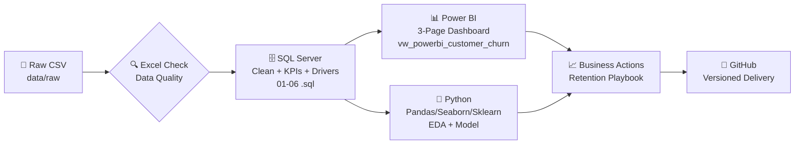

<p align="center">
  
  <br/><br/>
  <h1 align="center">📉 Customer Retention & Subscription Churn Analysis</h1>
  <p align="center"><b>Turn Churn Into Retention. Turn Data Into Revenue.</b></p>
  <p align="center">
    <i>A complete end-to-end analytics project — from SQL cleaning to Python modeling to Power BI decision dashboard — on 7,043 telecom subscribers.</i>
  </p>
</p>

<p align="center">
  <a href="#"></a>
  <a href="#"></a>
  <a href="#"></a>
  <a href="#"></a>
  <a href="#"></a>
  <a href="#"></a>
</p>

<p align="center">
  
  
  
  
  
</p>

> ⚠️ **Disclaimer:** This uses the fictional IBM Telco Customer Churn sample (cross-sectional). `MonthlyCharges` is used as a proxy for MRR. All findings are **associational, not causal**.

---

### 📚 Table of Contents
- [TL;DR — Executive Summary](#-tldr--executive-summary)
- [Key KPIs](#-key-kpis-at-a-glance)
- [Business Questions → Answers](#-business-questions--answers)
- [Architecture & Workflow](#️-architecture--workflow)
- [Repository Structure](#-repository-structure)
- [Dashboard Preview](#-power-bi-dashboard-preview)
- [Deep Dive Insights](#-deep-dive-insights)
- [Risk Segmentation](#-risk-segmentation--retention-prioritization)
- [Tech Stack](#️-tech-stack)
- [How to Run Locally](#-how-to-run-locally)
- [Business Recommendations](#-business-recommendations)
- [Future Roadmap](#-future-roadmap)
- [Author](#-author)

---

### 💡 TL;DR — Executive Summary

| Metric | Value |
| :--- | :--- |
| **Total Customers** | `7,043` |
| **Churned / Retained** | `1,869` / `5,174` |
| **Churn Rate** | **`26.54%`** |
| **Avg. Monthly Charge** | `$64.76` |
| **Total MRR (Proxy)** | `$456,116.60` |
| **Revenue At Risk / Month** | **`$139,130.85`** |

**One-line story:** *1 in 4 customers churn — concentrated in the first 6 months, on Month-to-Month contracts, paying via Electronic Check, on Fiber, without Tech Support.* Fix those 4 levers and you protect $1.6M+ ARR.

---

### 📊 Key KPIs at a Glance

| KPI | Value | Visual |
| :--- | :--- | :--- |
| 🔴 **Churn Rate** | **26.54%** | `1869` of `7043` |
| 💰 **Revenue at Risk** | **$139,130.85 / month** | 30.5% of MRR |
| 📈 **Total MRR** | $456,116.60 | Baseline |
| 💳 **Avg. Monthly Charge** | $64.76 | ARPU Proxy |
| 🎯 **Strict High-Risk Pool** | **631** customers | P1: `≥$70` + High-Risk |

---

### 🔍 Business Questions → Answers

| # | Question | Answer |
| :--- | :--- | :--- |
| **1** | What is the churn rate? | **26.54%** |
| **2** | How many churned vs retained? | **1,869 vs 5,174** |
| **3** | How much revenue is at risk? | **$139,130.85 / month** |
| **4** | Which contract churns most? | **Month-to-month 42.71%** > One year 11.27% > Two year **2.83%** |
| **5** | Does tenure matter? | **0-6M: 52.94%** churn vs **49-72M: 9.51%** — Tenure is protection |
| **6** | Riskiest payment method? | **Electronic Check 45.29%** (highest) |
| **7** | Riskiest internet type? | **Fiber 41.89%** > DSL 18.96% > No Internet 7.41% |
| **8** | Do support services help? | **No TechSupport 31.19%** vs Yes 15.17% <br/> **No OnlineSecurity 31.33%** vs Yes 14.61% |
| **9** | Who to prioritize? | **New MTM + Fiber + E-Check + High Charges** — 631 Strict High-Risk |
| **10** | What to do? | See [Recommendations](#-business-recommendations) |

---

### ⚙️ Architecture & Workflow



**Flow:** `Excel Validation` → `SQL Cleaning & Analysis` → `Power BI Dashboard` → `Python Validation & Churn Prediction` → `GitHub`

---

### 📁 Repository Structure

```
customer-retention-churn-analysis/
├── 📂 data/
│   ├── raw/                  # IBM Telco Churn CSV (7043 x 21)
│   └── processed/            # cleaned dataset
├── 📂 sql/
│   ├── 01_create_database_and_table.sql      # DB + staging table
│   ├── 02_cleaning_and_transformation.sql    # Dedup, nulls, TotalCharges, flags, bands
│   ├── 03_kpi_analysis.sql                   # Churn rate, MRR, at-risk
│   ├── 04_churn_driver_analysis.sql          # Contract, tenure, payment, fiber, support
│   ├── 05_customer_risk_segmentation.sql     # High/Med/Low + Priority 1/2/3
│   └── 06_create_powerbi_view.sql            # vw_powerbi_customer_churn
├── 📂 notebooks/
│   ├── 01_eda_and_validation.ipynb           # EDA that mirrors SQL KPIs
│   └── 02_churn_prediction_model.ipynb       # Sklearn model + feature importance
├── 📂 powerbi/
│   └── guide.md                              # Build guide + DAX
├── 📂 dashboard_screenshots/                 # P1 Executive, P2 Drivers, P3 Risk
├── 📂 docs/
│   └── key_insights.md                       # Deep insights doc
├── requirements.txt
└── README.md
```

---

### 🖥️ Power BI Dashboard Preview

> 3-page decision dashboard fed by `vw_powerbi_customer_churn` or cleaned CSV.

| Page 1: Executive Overview | Page 2: Churn Drivers | Page 3: Risk & Action |
| :---: | :---: | :---: |
|  |  |  |
| *KPI Cards + Churn Trend* | *Contract x Fiber Matrix* | *Priority 1/2/3 Table* |

*Replace placeholders with your actual `.png` exports. Recommended: 1600x900.*

---

### 🧠 Deep Dive Insights

#### 🔥 The Worst & Best Cells
| Segment | Churn Rate | Insight |
| :--- | :--- | :--- |
| **💀 Worst: MTM + Fiber** | **54.61%** | Price-sensitive power users with zero lock-in |
| **✅ Best: Two-Year + No Internet** | **0.78%** | Loyal, low-service, long-commit |
| **💸 High Charge Band** | **35.36%** | Willingness-to-pay ≠ loyalty |
| **👴 Seniors** | **41.68%** | Vulnerable — needs white-glove support |

#### 📉 Churn by Tenure Group
`0-6M (52.94%)` >> `7-12M` > `13-24M` > `25-48M` > `49-72M (9.51%)` — **Onboarding is everything.**

#### 💳 Payment Method — Hidden Risk Signal
`Electronic Check 45.29%` > `Mailed Check` > `Bank Transfer` > `Credit Card` — **Friction = Churn.** Nudge to Autopay.

#### 🛡️ Support Services = Retention Shield
Customers **without** Tech Support / Online Security churn at **2x** the rate. Support is not a cost center — it's insurance.

---

### 🎯 Risk Segmentation & Retention Prioritization

Generated in `05_customer_risk_segmentation.sql`:

| Risk Segment | Logic | Recommended Action |
| :--- | :--- | :--- |
| **🔴 High Risk** + `MonthlyCharges ≥ $70` | **Priority 1** | Retention Call + Contract Discount + Manager Escalation |
| **🟠 High Risk** | **Priority 2** | Proactive Retention Offer (email + SMS + call) |
| **🟡 Medium Risk** | **Priority 3** | Digital Engagement Campaign |
| **🟢 Low Risk** | **Monitor** | Loyalty & Upsell |

> **Strict High-Risk Pool: 631 customers** — start here for immediate ROI.

---

### 🛠️ Tech Stack

| Layer | Tools |
| :--- | :--- |
| **Data & DWH** | SQL Server (SSMS), T-SQL, Views |
| **Analysis & ML** | Python, Pandas, NumPy, Matplotlib, Seaborn, Scikit-learn, Jupyter, Joblib |
| **BI & Viz** | Power BI (DAX, 3-page dashboard) |
| **Ops** | Git, GitHub, Excel (initial audit) |

---

### 🚀 How to Run Locally

**1. Clone & Data**
```bash
git clone https://github.com/<your-username>/customer-retention-churn-analysis.git
cd customer-retention-churn-analysis
# CSV already in data/raw/ — else download IBM Telco Churn dataset
```

**2. SQL (SSMS) — Run in order**
```sql
-- Execute sequentially:
-- sql/01_create_database_and_table.sql
-- sql/02_cleaning_and_transformation.sql
-- sql/03_kpi_analysis.sql            -> Validate: 26.54% / $139,130.85
-- sql/04_churn_driver_analysis.sql
-- sql/05_customer_risk_segmentation.sql
-- sql/06_create_powerbi_view.sql
```

**3. Power BI**
```
Open Power BI Desktop -> Get Data -> SQL Server -> TelcoChurnDB -> vw_powerbi_customer_churn
# OR connect directly to data/processed/telco_cleaned.csv
# Follow powerbi/guide.md for DAX & visuals
```

**4. Python**
```bash
pip install -r requirements.txt
jupyter notebook
# Run notebooks/01_eda_and_validation.ipynb -> notebooks/02_churn_prediction_model.ipynb
```

---

### 💡 Business Recommendations

| # | Play | KPI to Move | Measure |
| :--- | :--- | :--- | :--- |
| **1** | **0-6M Onboarding Journey** (30/60/90-day check-ins + welcome credits) | 52.94% → <35% | 30/60/90-day retention |
| **2** | **MTM → Annual Upgrade** (transparent discount + no-exit fear) | 42.71% → <25% | Conversion rate |
| **3** | **E-Check → Autopay Incentive** ($5 off / loyalty points) | 45.29% → <30% | Autopay adoption |
| **4** | **Fiber High-Charge Plan Optimization** (right-plan + add-on, not discount) | 54.61% → <40% | ARPU + churn |
| **5** | **Free TechSupport/Security Trial** + proactive health check | 31% → <20% | Support attach rate |
| **6** | **Priority 1 Strike Team** (631 customers, ≥$70) — human call within 48h | Immediate save | Save rate & MRR saved |

---

### 🔮 Future Roadmap
- [ ] Add real `TotalCharges` cohort LTV (not proxy MRR)
- [ ] Deploy churn-risk API (Sklearn → FastAPI)
- [ ] A/B test framework for retention offers
- [ ] Power BI Incremental Refresh + Alerts

---

### 👤 Author

**Faraz Tahami** — Data Analytics | SQL • Python • Power BI


> [](https://linkedin.com/in/faraz-ft)
> [](https://your-portfolio.com)
> [](mailto:faraztahami.work@gmail.com)

---

<p align="center">
  <b>⭐ If this helped you, please give it a star — it helps others discover it!</b><br/>
  <i>Built with ❤️ for retention teams who hate surprises.</i>
</p>

<p align="center">
  
</p>
```

---
